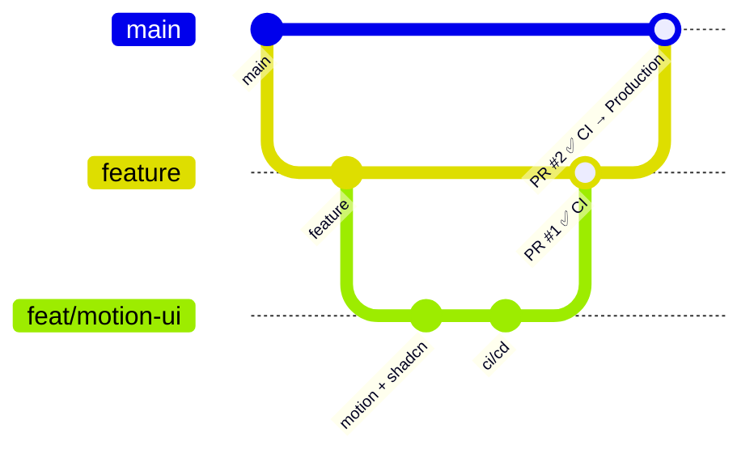

# Panduan CI/CD — Web-portofolio

Dokumen ini menjelaskan pipeline CI/CD di repo ini, langkah demi langkah, supaya bisa dipakai untuk belajar.

## 1. Konsep singkat

| Istilah | Artinya | Di repo ini |
| --- | --- | --- |
| **CI** (Continuous Integration) | Setiap perubahan kode **dicek otomatis** (lint, typecheck, build) sebelum digabung. | `.github/workflows/ci.yml` (GitHub Actions) |
| **CD** (Continuous Deployment) | Kode yang lolos **otomatis dipublikasikan** ke server. | Vercel Git integration (aktif), atau `.github/workflows/deploy.yml` (opsional) |
| **Workflow** | File YAML di `.github/workflows/` yang berisi instruksi untuk GitHub Actions. | `ci.yml`, `deploy.yml` |
| **Job** | Sekumpulan langkah yang jalan di satu mesin virtual. | `quality`, `build`, `deploy` |
| **Step** | Satu perintah, mis. `npm run lint`. | |
| **Runner** | Mesin (Linux) sementara milik GitHub yang menjalankan job. | `ubuntu-latest` |
| **Artifact** | File hasil job yang disimpan (bisa di-download). | folder `out/` hasil build |

## 2. Alur branch



1. Kerjakan fitur di branch kecil, mis. `feat/motion-ui`.
2. Buka **Pull Request** `feat/motion-ui → feature`. **CI jalan otomatis.** Vercel juga membuat **Preview URL**.
3. Kalau CI hijau ✅ dan preview oke, merge ke `feature`.
4. Buka PR `feature → main`. CI jalan lagi.
5. Merge ke `main`, lalu Vercel men-deploy ke **Production**.

## 3. Apa yang dilakukan `ci.yml`

```
quality  ──►  build
(lint + typecheck)  (next build → upload artifact)
```

| Bagian | Fungsi |
| --- | --- |
| `on:` | Kapan workflow jalan: saat PR ke `main`/`feature`, saat push ke `main`/`feature`, manual (`workflow_dispatch`), atau dipanggil workflow lain (`workflow_call`). |
| `concurrency:` | Kalau kamu push 2x cepat, run lama dibatalkan agar tidak buang waktu. |
| `permissions: contents: read` | Prinsip *least privilege*: CI hanya boleh membaca kode. |
| `actions/checkout` | Mengambil kode repo ke runner. |
| `actions/setup-node` + `cache: npm` | Memasang Node versi dari `.nvmrc` dan menyimpan cache npm supaya install berikutnya lebih cepat. |
| `npm ci` | Install **persis** sesuai `package-lock.json` (lebih ketat dari `npm install`). |
| `npm run lint` | ESLint: cek bug umum & aturan React Hooks. |
| `npm run typecheck` | TypeScript: cek kesalahan tipe. |
| `needs: quality` | Job `build` baru jalan kalau `quality` lolos. |
| `actions/cache` (`.next/cache`) | Cache build Next.js agar build berikutnya lebih cepat. |
| `actions/upload-artifact` | Menyimpan folder `out/` selama 7 hari, bisa di-download dari halaman run. |

### Menjalankan pengecekan yang sama di lokal

Sebelum push, jalankan:

```bash
npm run check
```

Isinya sama dengan CI: `lint → typecheck → build`. Kalau lolos di lokal, kemungkinan besar CI juga hijau.

## 4. CD: dua mode

### Mode A — Vercel Git integration (aktif sekarang) ✅

Vercel terhubung langsung ke repo GitHub:

- Push ke branch apa pun / buka PR → **Preview deployment** (URL unik, dikomentari otomatis oleh bot Vercel di PR).
- Merge ke `main` → **Production deployment**.

Kelebihan: tanpa konfigurasi. Kekurangan: Vercel tetap deploy walaupun CI merah. Solusinya ada di bagian 5 (branch protection).

### Mode B — Deploy lewat GitHub Actions (`deploy.yml`, opsional, untuk belajar)

Alurnya: `CI (reusable) → vercel pull → vercel build → vercel deploy --prebuilt`.
Deploy **hanya terjadi kalau CI lolos**, dan URL preview dikomentari ke PR oleh workflow kamu sendiri.

Cara mengaktifkan:

1. Buat token di <https://vercel.com/account/tokens>.
2. Di folder project jalankan `npx vercel link`, lalu buka `.vercel/project.json` untuk melihat `orgId` dan `projectId`.
3. Di GitHub: **Settings → Secrets and variables → Actions**
   - **Secrets**: `VERCEL_TOKEN`, `VERCEL_ORG_ID`, `VERCEL_PROJECT_ID`
   - **Variables**: `DEPLOY_WITH_ACTIONS` = `true`
4. Matikan auto-deploy Vercel agar tidak deploy dobel: tambahkan file `vercel.json`:
   ```json
   { "git": { "deploymentEnabled": false } }
   ```
5. Push/buka PR, lalu lihat tab **Actions** → workflow **Deploy**.

Untuk kembali ke Mode A: hapus variable `DEPLOY_WITH_ACTIONS` dan `vercel.json`.

## 5. Branch protection (sangat disarankan)

Supaya kode yang gagal CI **tidak bisa** di-merge:

**Settings → Rules → Rulesets → New branch ruleset**

- Target branches: `main` dan `feature`
- ✅ *Require a pull request before merging*
- ✅ *Require status checks to pass* → tambahkan `Lint & typecheck` dan `Build`
- ✅ *Block force pushes*

Hasilnya, tombol **Merge** di PR terkunci sampai CI hijau.

## 6. Dependabot

`.github/dependabot.yml` membuat PR otomatis (ke branch `feature`) ketika ada update dependency atau versi GitHub Action. Setiap PR itu juga menjalankan CI, jadi kamu langsung tahu apakah update aman.

## 7. Membaca hasil CI

- Di PR, bagian bawah menampilkan ✅ / ❌ per job. Klik **Details** untuk melihat log.
- Tab **Actions** di repo berisi riwayat semua run.
- Run gagal? Buka step yang merah, baca errornya, perbaiki di lokal (`npm run check`), lalu push lagi. CI otomatis jalan ulang.

## 8. Latihan

1. Buat branch baru, sengaja tulis kode dengan error tipe (mis. `const x: number = "a"`), buka PR → lihat CI merah ❌.
2. Perbaiki, push lagi → CI hijau ✅.
3. Tambahkan step baru di `ci.yml`, misalnya `npm audit --audit-level=high`, lalu lihat hasilnya.
4. Coba aktifkan Mode B di atas.
